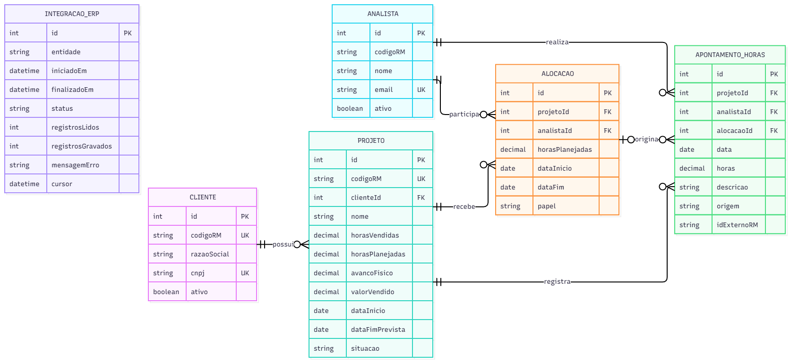
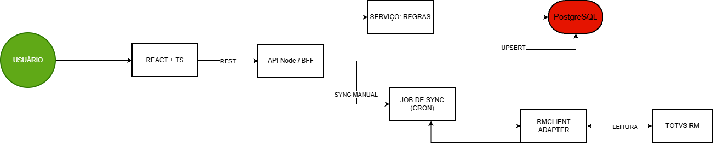

# Painel de Projetos

**Painel de Projetos** é uma API REST desenvolvida simulando o back-end do módulo de acompanhamento de saúde financeira e física de projetos, centralizando saldos de horas, alocações e integração/sincronização com o ERP TOTVS RM.

## Índice

- [Visão Geral](#visão-geral)
- [Tecnologias Utilizadas](#tecnologias-utilizadas)
- [Como Executar](#como-executar)
- [Modelagem do Domínio](#modelagem-do-domínio)
- [Arquitetura da Solução](#arquitetura-da-solução)
- [Design da API](#design-da-api)
- [Regras de Negócio](#regras-de-negócio)
- [Decisões e Trade-offs](#decisões-e-trade-offs)
- [Evolução, Escala e Resiliência](#evolução-escala-e-resiliência)

## Visão Geral

A **api** foi desenvolvida com o objetivo de centralizar e expor métricas de saúde dos projetos para a coordenação (horas vendidas, planejadas e realizadas, saldo de horas e status de criticidade) sem depender diretamente da disponibilidade do ERP TOTVS RM.

O projeto conta com **1 endpoint** que lista projetos com o saldo de horas calculado.

**Fonte dos dados →** O RM é a fonte principal, mas o painel busca em um banco próprio que seria sincronizado com o banco oficial a cada 30 minutos, visando a performance para casos do sistema RM estar fora do ar ou lento.

**Arquitetura →** Front (React) - API/BFF (Node.js) - Banco relacional (PostgreSQL/SQLite) - Camada de integração - TOTVS RM.

O projeto utiliza o SQLite com suporte a Migrations e Seeds configurados via Knex:

- **Migrations:** Cria a tabela `PROJETO`.
- **Seeds:** Populam o banco local com **20 projetos fictícios** configurados para simular cenários reais de paginação e filtros.

A aplicação simula o módulo do portal, permitindo a consulta de:

- Projetos e suas respectivas informações
<!-- - Apontamentos de horas dos analistas
- Alocações de analistas por projeto
- Sincronização manual e automática com o ERP TOTVS RM
- Cadastros auxiliares de clientes e analistas -->

A API possui rotas organizadas e segue uma estrutura baseada em controladores/camadas (BFF).

Principais funcionalidades:

- **GET** → Listagem e consulta de projetos, dashboard, alocações, apontamentos, status de integração, clientes e analistas
- **POST** → Registro de apontamentos e disparo manual de sincronização com o ERP
- **PUT** → Edição de apontamentos existentes
- **DELETE** → Remoção/cancelamento de apontamentos de horas

Os dados seriam armazenados em um banco relacional **PostgreSQL** (com suporte a **SQLite** / mock em memória para facilidade nos testes locais).

A sincronização de dados com o ERP seria realizada de forma automática a cada 30 minutos via job agendado (`node-cron`), buscando alterações de forma incremental e registrando os resultados na tabela de auditoria de integração.

## Tecnologias Utilizadas

- **Node.js**: Ambiente de execução do JavaScript no servidor
- **TypeScript**: Tipagem estática para maior segurança e qualidade no código
- **Express**: Framework para criação da API REST
- **SQLite / PostgreSQL**: Banco de dados relacional para armazenamento local e de produção
- **Knex**: Query builder para integração com o banco de dados
- **Postman / Insomnia**: Ferramenta utilizada para testar as rotas da API
<!-- - **node-cron**: Agendador de tarefas para o job de sincronização periódica -->

## Como Executar

1. Clone o repositório:

```bash
git clone <url-do-repositorio>
```

2. Acesse a pasta do projeto:

```bash
cd painel-projetos
```

3. Instale as dependências:

```bash
npm install
```

4. Execute as migrations ou inicie a aplicação:

```bash
npm run knex migrate:latest
npm run knex -- seed:run
npm run dev
```

5. Utilize o **Postman** ou **Insomnia** para testar as rotas da API (servidor rodando em `http://localhost:3333`).

## Modelagem do Domínio

### Relacionamentos

- **Cliente 1:N Projeto**
- **Projeto N:N Analista**, resolvido pela tabela `Alocacao` (que ainda guarda dados próprios: período e horas planejadas)
- **Projeto 1:N Apontamento_Horas**
- **Analista 1:N Apontamento_Horas**

### Diagrama



## Arquitetura da Solução

### Camadas

- Front (React)
- API/BFF (Node.js)
- Banco relacional (PostgreSQL)
- Camada de integração
- TOTVS RM

### Fluxo

Um job agendado é executado a cada 30 minutos utilizando o `node-cron` e busca somente as alterações realizadas após o último cursor, os dados são normalizados e gravados via `upsert` no banco. O resultado de cada execução é registrado no `INTEGRACAO_ERP`.



## Design da API

Prefixo base: `/api/v1/`

### Projetos e Indicadores

- **`GET /projetos?status=&clienteId=&page=&pageSize=`**: Lista todos os projetos com saldo de horas e status calculado (Saudável, Atenção, Crítico).

**Resposta 200 OK:**

```json
{
  [
    {
      "id": 14,
      "codigoRM": "RM-014",
      "clienteId": 3,
      "nome": "Implementação LGPD",
      "horasVendidas": 70,
      "horasPlanejadas": 70,
      "avancoFisico": 100,
      "valorVendido": 10500,
      "dataInicio": "2026-01-05",
      "dataFimPrevista": "2026-02-20",
      "situacao": "CONCLUIDO",
      "created_at": "2026-10-13 00:44:46",
      "updated_at": "2026-10-13 00:44:46",
      "horasRealizadas": 30,
      "saldoHoras": 40
    }
  ]
}
```

**Erro 400 Bad Request:**

```json
{ "erro": "Parâmetros de consulta inválidos", "mensagem": "Erro teste" }
```

- **`GET /projetos/{id}/dashboard`**: Retorna métricas detalhadas de saúde financeira, avanço físico e saldo de um projeto específico.
- **`GET /projetos/{id}/alocacoes`**: Retorna os analistas alocados e horas planejadas para determinado projeto.

### Apontamento de Horas

- **`GET /apontamentos`**: Lista o histórico de apontamentos de horas com filtros por projeto, analista ou período.
- **`POST /apontamentos`**: Registra um novo apontamento de horas realizado por um analista.
- **`PUT /apontamentos/{id}`**: Edita um apontamento de horas existente.
- **`DELETE /apontamentos/{id}`**: Cancela/remove um apontamento de horas.

### Sincronização e ERP (TOTVS RM)

- **`POST /integracao/sync-rm`**: Dispara a sincronização manual de dados entre o ERP TOTVS RM e o banco local.
- **`GET /integracao/status`**: Retorna informações da última sincronização com o TOTVS RM e status de conectividade.

### Cadastros Auxiliares

- **`GET /clientes`**: Retorna a lista de clientes para filtros de busca no painel.
- **`GET /analistas`**: Retorna a lista geral de analistas disponíveis para alocação e seleção de apontamento.

## Regras de Negócio

- **Saldo de Horas:** Horas vendidas - Horas realizadas (Apontadas).
- **Avanço Financeiro (%):** (Horas realizadas / Horas vendidas) \* 100.
- **Avanço Físico (%):** Percentual da entrega do projeto informado pela coordenação.

### Classificação de Status:

- **SAUDÁVEL (Verde):** Consumo de horas menor que 75%.
- **ATENÇÃO (Amarelo):** Consumo de horas entre 75% e 99%.
- **CRÍTICO (Vermelho):** Consumo de horas igual ou superior a 100% OU consumo maior que 90% e avanço físico menor que 70%.

_OBS.: Regras avaliadas na ordem: crítico, atenção e saudável._

## Decisões e Trade-offs

### Banco de dados local sincronizado com o RM

- **Escolha:** O painel consulta as informações de um banco próprio, que é atualizado a cada 30 minutos com os dados do TOTVS RM.
- **Por quê:** Se o RM estiver fora do ar ou lento, os usuários continuam conseguindo usar o painel sem travamentos. _Obs.: Os dados na tela podem ter alguns minutos de atraso em relação ao RM._

### Sincronização automática por tempo (Cron)

- **Escolha:** Rotina no backend (`node-cron`) que busca no RM (SQLite/mock em memória no exemplo) apenas o que mudou desde a última atualização.
- **Por quê:** É uma solução simples de implementar e não exige alterar nenhuma configuração no sistema do RM. Se necessário, botão de "Sincronizar agora" para quando a coordenação precisar do dado atualizado na hora.

### Camada de integração separada (RMClient)

- **Escolha:** Criar um código/serviço separado no backend responsável apenas por conversar com o RM e formatar os dados.
- **Por quê:** Se o RM mudar a forma de enviar as informações, alteramos apenas esse arquivo sem quebrar o restante do sistema.

### Cálculo de saldo e status feito na hora da consulta

- **Escolha:** O saldo de horas e a cor do status (Verde, Amarelo, Vermelho) são calculados por uma função no código sempre que a tela é aberta.
- **Por quê:** Garante que o status nunca fique desatualizado ou diferente das horas lançadas, além de ser fácil de alterar as regras no futuro.

### Comparar Avanço Físico com Consumo de Horas

- **Escolha:** O percentual de avanço físico vem da coordenação/RM e é comparado com o percentual de horas gastas.
- **Por quê:** Essa comparação é o que permite identificar se um projeto está crítico (por exemplo, quando gastou 90% do tempo mas só entregou metade do trabalho).

### Organização simples do Backend (API / BFF)

- **Escolha:** Criar uma API única em Node.js dividida em pastas organizadas (rotas, regras de negócio e banco).
- **Por quê:** É a forma mais simples e eficiente de construir o painel sem complicação desnecessária de estrutura.

### Uso de Banco de Dados Relacional

- **Escolha:** Usar banco relacional (SQLite para rodar fácil nos testes locais e PostgreSQL para o ambiente final).
- **Por quê:** Os dados do sistema dependem muito de ligações entre si (Cliente tem Projetos, Projeto tem Alocações, Alocação tem Apontamentos), e pela velocidade/eficiência com consultas em larga escala.

## Evolução, Escala e Resiliência

### ERP fora do ar ou lento

- Painel segue funcionando com o banco local; mostra aviso de dados defasados (40+ min).
- Timeout + retry com backoff exponencial no RMClient.
- Circuit breaker: após N falhas, para de chamar o RM por um tempo.
- Sync incremental (por cursor de data) e idempotente.
- Alertas quando o sync falhar repetidamente.

### Performance

- Paginação e filtros no servidor; índices em `projetoId`, `data`, `clienteId`.
- Cache (Redis) para listagens muito acessadas.
- Relatórios pesados gerados de forma assíncrona (job + download).
- Observabilidade: logs estruturados, métricas de latência, health check.

### Segurança

- SSO Corporativo.
- Perfis (coordenação x analista).
- Analista só lança horas em si mesmo.

### Automatização e IA

- Relatório semanal enviado por e-mail à coordenação. Os números são calculados pelo sistema (mesmas regras do painel) e a IA redige o texto a partir deles, destacando projetos críticos e mudanças da semana.

### Uso de Ferramentas de IA Generativa

Este projeto contou com o apoio de ferramentas de IA para obter maior produtividade, especificamente para:

- Gerar dados fictícios e variados para os arquivos de _seed_ do banco de dados local.
- Auxiliar na estruturação e formatação da documentação em Markdown (`README.md`).
